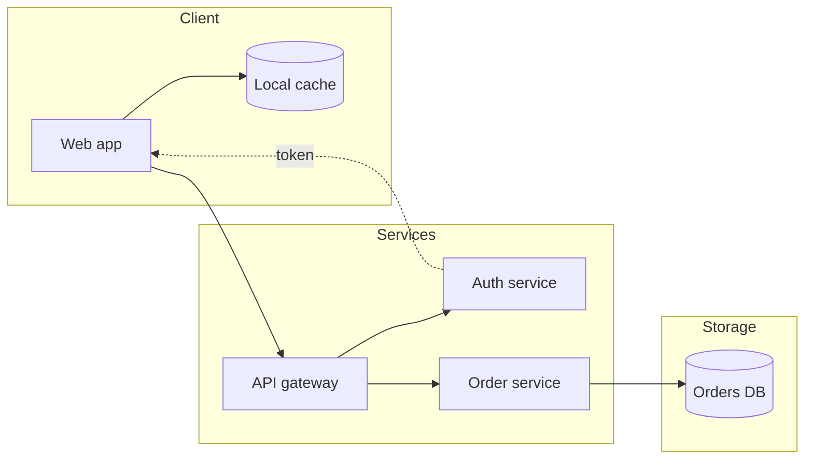

import SineWave from './SineWave.astro';

Bên cạnh định dạng văn bản Markdown tiêu chuẩn, Where1Returns còn cung cấp các khung chú thích (callouts), công thức toán học, sơ đồ, hộp hiển thị ảnh (lightbox) và hỗ trợ các thành phần tương tác thông qua MDX.

## Khung chú thích (Callouts)

> [!QUESTION]
> Question Question Question

> [!NOTE]
> **Note**, [liên kết](https://mermaid.js.org/syntax/flowchart.html) `Note`

> [!INFO]
> Info Info Info

> [!TIP]
> Helpful advice for doing things better or more easily.

> [!SUCCESS]
> Key information users need to know to achieve their goal.

> [!IMPORTANT]
> Key information users need to know to achieve their goal.

> [!WARNING]
> Urgent info that needs immediate user attention to avoid problems.

> [!CAUTION]
> Advises about risks or negative outcomes of certain actions.

> [!DANGER]
> Advises about risks or negative outcomes of certain actions.

### Tiêu đề tùy chỉnh

> [!WARNING] Kiểm tra trước khi xuất bản
> Hãy xem trước bài viết và xác nhận rằng các hình ảnh cũng như liên kết đều hoạt động chính xác.

Bạn có thể tạo khung chú thích bằng các ký hiệu như `> [!NOTE]` hoặc `> [!TIP]`. Hãy thêm tiêu đề tùy chỉnh ngay sau ký hiệu đó.

## Công thức toán học (KaTeX)

Các công thức toán học nội dòng như $E=mc^2$ sẽ hiển thị ngay trong dòng văn bản.
Đối với các công thức hiển thị độc lập, hãy đặt chúng trong cặp ký hiệu `$$`:

$$\frac{1}{3}$$

$$
\int_0^1 x^2\,dx = \frac{1}{3}
$$

## Sơ đồ (Mermaid)

Bạn có thể tạo sơ đồ bằng cách sử dụng khối mã (code block) với định danh [`mermaid` DOC](https://mermaid.js.org/syntax/flowchart.html):



Hãy mở rộng phần mã nguồn để xem chi tiết. Màu sắc của sơ đồ sẽ tự động thay đổi tùy theo chế độ hiển thị sáng hoặc tối.

## Hộp hiển thị ảnh (PhotoSwipe lightbox)

Nhấp vào hình ảnh để xem ở kích thước đầy đủ. Bạn có thể phóng to, chuyển đổi giữa các ảnh hoặc nhấn phím Escape để đóng hộp hiển thị.


## Các thành phần tương tác trong MDX

Hãy kéo các thanh trượt để điều chỉnh biên độ, chu kỳ và pha ban đầu của sóng hình sin.
Biểu đồ sẽ cập nhật ngay lập tức.
Sử dụng các phím mũi tên để thực hiện những điều chỉnh nhỏ, hoặc nhấp vào “Reset” (Đặt lại) để khôi phục các giá trị ban đầu.

<SineWave lang="en" />

## Chèn một thành phần (component)

Nhập (import) một thành phần vào tệp `.mdx`, sau đó đặt nó vào phần nội dung:

```mdx
import SineWave from './SineWave.astro';

<SineWave lang="en" />
```

Ví dụ này giữ `SineWave.astro`, cùng với các hàm hỗ trợ tính toán và nội dung văn bản đi kèm, ngay trong gói (bundle) của bài viết.
Thuộc tính `lang` được dùng để thiết lập ngôn ngữ giao diện cho thành phần đó.
Đối với các thành phần chỉ dùng một lần, hãy đặt chúng trong gói của bài viết tương ứng, hoặc viết mã đánh dấu (markup) đơn giản trực tiếp trong tệp MDX.
Với các thành phần được sử dụng chung cho nhiều bài viết, hãy đặt chúng vào thư mục `custom/components/` và nhập vào bằng cách sử dụng đường dẫn tương đối.

## Cấu hình cho từng mục (entry)

Bạn có thể thiết lập các giá trị mặc định chung cho các thành phần mở rộng (enhancements), đồng thời ghi đè lên các giá trị này trong phần frontmatter của từng mục. Xem thêm tại mục [Các tùy chọn ghi đè cho thành phần mở rộng](../enhancement-overrides/).
